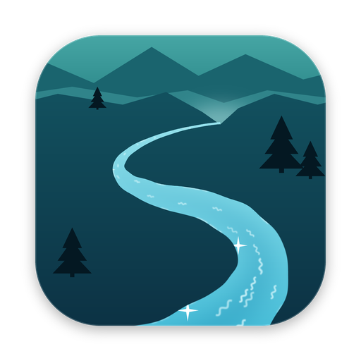
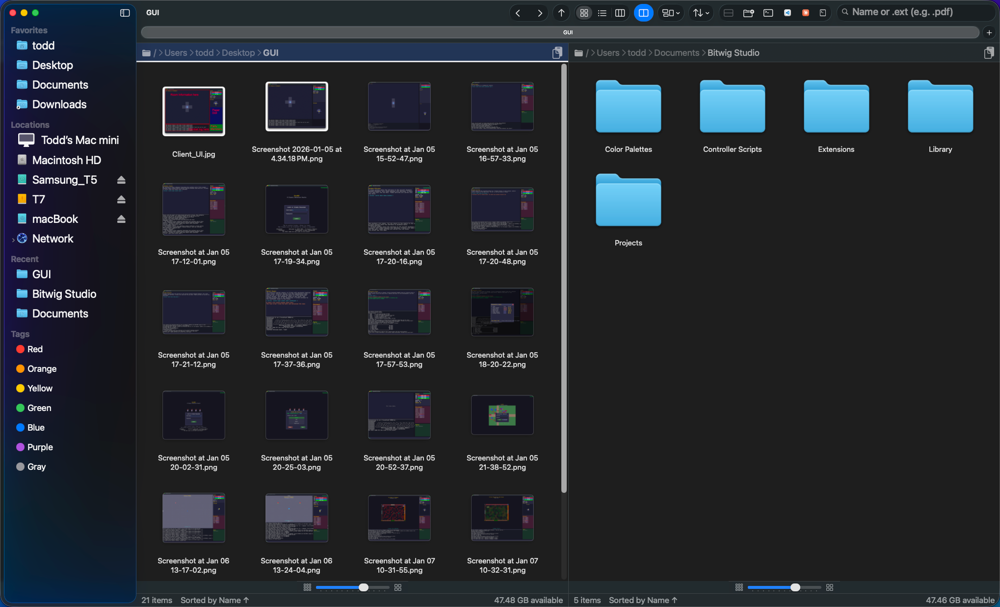

<p align="center">
  
</p>

# Selway

A native macOS file manager that works like Finder and adds what Finder leaves out:
two panes side by side, a code editor and a Markdown reader in their own windows,
and one-click buttons that open the current folder in Terminal or your editor. It
runs on macOS 14 or later, on Apple Silicon and Intel, in English, French, German,
Italian, Japanese and Spanish.

<p align="center">
  
</p>

- **Finder's views and habits.** Columns, List and Icons, Quick Look with the Space
  bar, Finder's keyboard shortcuts, tabs (⌘T), and a sidebar with Favorites,
  Locations, pinned and recent folders, and tags.
- **Dual pane.** View → Show Dual Pane (⌃⌘P) puts a second pane beside the first.
  Copy to Other Pane (F5) and Move to Other Pane (F6) work on the selection, with Undo.
- **A code editor and a Markdown reader.** Double-click a text file to edit it with
  syntax highlighting, a command palette (⌘⇧P) and a minimap. Markdown files open
  rendered, with an Edit mode one click away.
- **Open in Terminal, VS Code, Cursor, Claude Code or Codex.** Toolbar buttons appear
  only for the tools installed on your Mac. iTerm, Ghostty or Warp can stand in for
  Terminal (Settings → Integrations).
- **Finder's color tags.** Selway writes macOS's own tag format, so tags you set show
  in Finder and Finder's show in Selway. Click a tag in the sidebar to find every file
  that has it.
- **Search.** This folder, this folder and its subfolders, or the whole Mac through
  Spotlight, including search by extension (type `.pdf`).
- **Disks and servers.** The computer in Locations shows free space on each disk.
  Connect to Server (⌘K) mounts SMB, AFP, NFS, WebDAV and FTP shares, and saved
  servers stay in the sidebar. Time Machine disks list their backups.
- **File operations with Undo.** Copy, move, rename, duplicate, Move to Trash and
  Delete Permanently, compress to `.zip`, and extract `.zip` and tar archives. Drag
  and drop follows Finder's rules.

[CHANGELOG.md](CHANGELOG.md) has the full record of what Selway does.

## Download

The [latest release](https://github.com/toddbartholow/selway/releases/latest) has a
universal `.dmg`. Open it and drag Selway into Applications. To use Selway from
Finder's shortcut menu, turn it on in System Settings → General → Login Items &
Extensions → Extensions.

Releases that aren't notarized by Apple are blocked the first time you open them (the
DMG's *Install & First Open.txt* says which kind you have). Approve Selway once:

- **macOS 15 Sequoia and later:** open Selway and click **Done** on the warning. Then
  go to System Settings → Privacy & Security, find "Selway was blocked" and click
  **Open Anyway**.
- **macOS 14 Sonoma:** in Applications, Control-click Selway, choose **Open**, then
  **Open** again.

Don't remove the quarantine flag with `xattr`: that turns off Gatekeeper's check for
the app instead of approving it once. The first time you browse Desktop, Documents or
Downloads, or use Get Info or Open in Terminal, macOS asks for permission as it does
for any file manager.

## Privacy

Selway has no telemetry and no account. It goes online only for:

- the update check, about once a day, which Settings → General can turn off
  ([SECURITY.md](SECURITY.md) says what it sends and how updates are verified);
- remote images in a Markdown document, and only after you click **Load Remote
  Images** for that document;
- file servers you connect to yourself;
- looking for file servers on your network, and only while the sidebar's Network row
  is open.

## Build

```sh
git clone https://github.com/toddbartholow/selway.git
cd selway
open Selway.xcodeproj    # build and run with ⌘R
./scripts/test.sh        # the tests, no Xcode needed
```

Requirements, the full test suite and the UI tests are in
[CONTRIBUTING.md](CONTRIBUTING.md).

## Folders opened outside Selway

Folders opened from the Desktop, Finder, the Dock or other apps open in Finder: macOS
26 doesn't let another app take that over. To open one in Selway, choose **Open in
Selway** from Finder's shortcut menu, or run `open -a Selway some/folder`.

Selway 0.5.19 and earlier had an **Open folders in Selway** setting. If you turned it
on, Settings → General shows **Restore Finder**, which undoes it as far as macOS
allows. These changes belong to your user account and outlast the app. If you have
already deleted Selway, run `defaults delete -g NSFileViewer` and log out and back in;
macOS normally gives folders back to Finder once the app that took them is gone.

## Credit

Selway began as a fork of [FinderFlow](https://github.com/Gtarafdar/FinderFlow) by
Gobinda Tarafdar.

## License

MIT. Copyright (c) 2026 Gobinda Tarafdar and (c) 2026 Todd Bartholow. See
[LICENSE](LICENSE).

The third-party software in Selway keeps its own licenses: the bundled Ace code
editor (BSD 3-Clause, see [Selway/AceEditor/LICENSE](Selway/AceEditor/LICENSE)) with
the libraries its build includes, the Sparkle update framework (MIT) and the other
components. Selway lists each one with its license in Selway > About Selway >
Acknowledgments.

Selway is an independent project and is not affiliated with Apple. Finder is a
trademark of Apple Inc.
